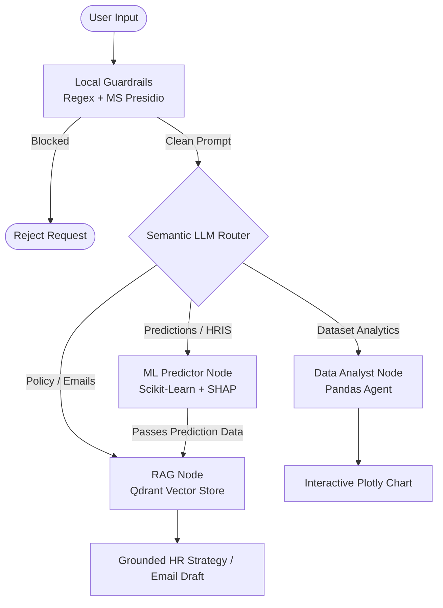

# HR Retention & Attrition Copilot

An enterprise-grade, multi-agent AI Copilot designed for People Operations and HR Business Partners. This application autonomously predicts employee flight risk using Machine Learning (Scikit-Learn), extracts behavioral drivers using SHAP, visualizes dataset trends, and drafts DOLE-compliant retention strategies via Retrieval-Augmented Generation (RAG).

## 🏗️ Architecture

The Copilot is orchestrated using a **LangGraph state machine** and a semantic LLM router. All prompts are pre-processed locally for safety and PII redaction before touching any external LLM APIs.



## ✨ Key Features

* **Agentic Routing:** Dynamically routes user intent to the correct analytical or generative sub-agent.
* **Predictive Analytics:** Uses a trained Random Forest model mapped to 27 employee features to calculate real-time churn probabilities.
* **Interactive SHAP Visualizations:** Explains *why* an employee is a flight risk through dynamic Plotly bar charts.
* **Mock HRIS Integration:** Autonomously fetches representative employee profiles from the dataset by department name or Employee ID.
* **Zero-Cost PII Redaction:** Utilizes **Microsoft Presidio** and SpaCy NLP to instantly redact emails, SSNs, and phone numbers locally before the prompt is sent to OpenAI.
* **Ragas Evaluated RAG:** Policy retrieval is strictly grounded in the internal HR Playbook, evaluated for context precision and faithfulness.

## 🛠️ Tech Stack

* **Frontend:** Streamlit, Plotly
* **Orchestration:** LangGraph, LangChain
* **LLM & Embeddings:** OpenAI (`gpt-4o-mini`, `text-embedding-3-small`)
* **Machine Learning:** Scikit-Learn, Pandas, SHAP
* **Vector Database:** Qdrant (In-Memory)
* **Security & Guardrails:** Microsoft Presidio, Regular Expressions
* **Observability:** LangSmith

## 📁 Repository Structure

```text
ATTRITIONTEST/
├── .devcontainer/
├── .streamlit/
│   └── secrets.toml           # App secrets (Do NOT commit to version control)
├── datasets/
│   ├── hr_testset.csv
│   ├── Mock Employee Retention & HR Policy Playbook.pdf
│   └── WA_Fn-UseC_-HR-Employee-Attrition.csv
├── models/
│   ├── model_2024_05_16.sav
│   ├── encoder_2024_05_16.sav
│   └── explainer_2024_05_16.sav
├── notebooks/
│   ├── AgentExperimentation.ipynb
│   ├── AttritionTest.ipynb
│   └── interactive_chart.json
├── .env                       # Local environment variables (Do NOT commit)
├── agent.py                   # LangGraph architecture & Tools
├── app.py                     # Streamlit frontend & Guardrails
├── interactive_chart.json     # Generated artifact (Ephemeral)
├── readme.md                  # Project documentation
├── requirements.txt           # Python dependencies
└── run_evals.ipynb            # Ragas evaluation pipeline
```

## ⚙️ Configuration (Secrets Template)

To ensure no API keys are committed to the repository, this project uses Streamlit's `secrets.toml` file instead of a traditional `.env` file for the application environment.

1. Ensure you have the `.streamlit` folder in the root directory.
2. Inside that folder, create a file named `secrets.toml`.
3. Add the following configuration template (replace the placeholder strings with your actual keys). 

**⚠️ CRITICAL: Ensure `.streamlit/secrets.toml` and `.env` are included in your `.gitignore` file.**

```toml
# .streamlit/secrets.toml

# OpenAI Configuration
OPENAI_API_KEY = "sk-proj-your-openai-api-key-here"

# LangSmith Observability (Optional but highly recommended for evaluation)
LANGCHAIN_TRACING_V2 = "true"
LANGCHAIN_ENDPOINT = "https://api.smith.langchain.com"
LANGCHAIN_API_KEY = "lsv2_pt_your_langsmith_api_key_here"
LANGCHAIN_PROJECT = "HR-Retention-Copilot"
```

## 🚀 Setup and Installation

### 1. Prerequisites

Ensure you have **Python 3.9** installed. *(Note: Python 3.10+ may cause compatibility issues with older pickled Scikit-Learn models).*

### 2. Create a Virtual Environment

```bash
python -m venv capstone_env
source capstone_env/bin/activate  # On Windows: capstone_env\Scripts\activate
```

### 3. Install Dependencies

Due to specific binary dependencies for Microsoft Presidio and Scikit-Learn, ensure `numpy` and `spacy` are pinned correctly by installing from the `requirements.txt`:

```bash
pip install -r requirements.txt
```

### 4. Download the SpaCy NLP Model

This step is required for Microsoft Presidio to perform local PII redaction securely:

```bash
python -m spacy download en_core_web_lg
```
*(Note: For cloud deployments, this is handled via the direct `.whl` URL inside `requirements.txt`)*.

## ▶️ Running the Application

Start the Streamlit server:

```bash
streamlit run app.py
```

The application will launch in your default web browser at `http://localhost:8501`.

## 🧪 Experimentation and Evaluation

* **Prototyping:** Explore the Jupyter notebooks inside the `notebooks/` folder (e.g., `AgentExperimentation.ipynb`) to see step-by-step logic validations of the Semantic Router, Pandas Agent, and Qdrant ingestions without running the UI.
* **Ragas Evals:** Run `run_evals.ipynb` in the root directory using the `datasets/hr_testset.csv` dataset to calculate Faithfulness, Answer Relevancy, and Context Precision scores for the RAG node.